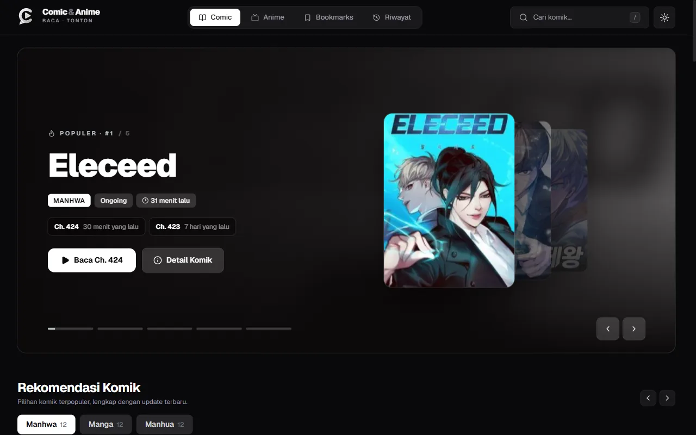
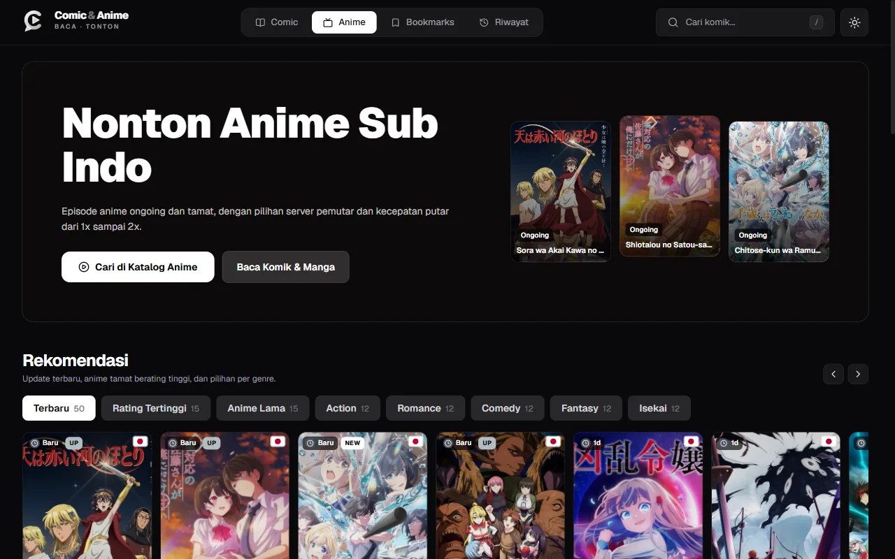
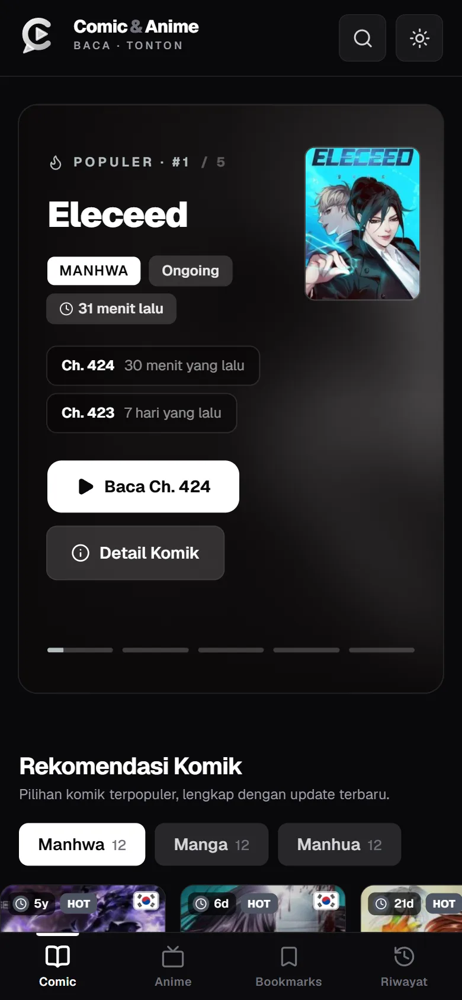

# Comic and Anime

Pembaca komik dan pemutar anime sub Indo berbasis Next.js. Daftar komik diambil dari komikindo.ch, daftar anime dari otakudesu.blog. Bookmark dan riwayat bacaan disimpan di browser, tanpa akun.



<p>
  
  
</p>

Semua sampul dan judul pada screenshot adalah milik pemegang hak ciptanya masing-masing.

## Fitur

- Dua mode baca: webtoon (scroll vertikal) dan manga (balik halaman, arah LTR atau RTL).
- Katalog komik dengan filter genre, tipe, status, dan urutan, plus pagination.
- Pemutar anime dengan pilihan server dan kecepatan putar 1x sampai 2x.
- Pencarian dari mana saja: tekan `/` atau `Ctrl+K`.
- Bookmark dan riwayat bacaan (halaman terakhir per komik), tersimpan di `localStorage`.
- Tema terang dan gelap. Tata letak diuji sampai lebar 390 px.

## Menjalankan

Butuh Node.js 20 atau lebih baru.

```bash
npm install
npm run dev
```

Buka http://localhost:3000. Untuk produksi, `next.config.ts` memakai `output: "standalone"`, jadi jalur yang sudah disiapkan adalah Docker (port host 3010):

```bash
docker compose up -d --build
```

Variabel opsional: `DISABLE_CACHE_WARMUP=1` mematikan pemanasan cache saat server start.

## Struktur

- `src/app`: halaman (`/`, `/anime`, `/comic/[id]`, `/reader/...`, `/bookmarks`, `/history`) dan route API.
- `src/components`: komponen UI per area (`comic`, `anime`, `reader`, `layout`, `ui`).
- `src/services`: scraper dan parser untuk sumber data, semuanya memakai `use cache`.
- `src/utils`, `src/hooks`, `src/types`: penyimpanan lokal, cache klien, dan tipe data.

Detail cache dan aturan menambah fitur ada di [docs/cache.md](docs/cache.md). Aturan arsitektur kode ada di [AGENTS.md](AGENTS.md).

## Berkontribusi

Kontribusi dalam bentuk bug report, perbaikan, atau fitur baru dipersilakan. Baca [CONTRIBUTING.md](CONTRIBUTING.md) dulu. Kalau sumber data berubah struktur dan scraper rusak, buka issue dengan URL halaman yang gagal: itu perbaikan yang paling sering dibutuhkan.

## Catatan hukum

Proyek ini tidak menyimpan atau meng-host komik, gambar, maupun video. Konten diambil saat runtime dari situs pihak ketiga yang bisa berubah atau hilang kapan saja, dan hak ciptanya milik kreator dan penerbit aslinya. Lisensi MIT hanya berlaku untuk kode di repositori ini, bukan untuk konten dari sumber tersebut. Kamu bertanggung jawab atas cara kamu memakai dan menjalankannya.

## Lisensi

[MIT](LICENSE)
